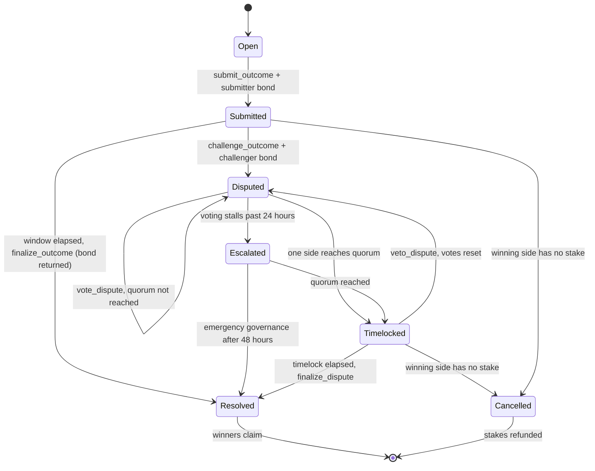
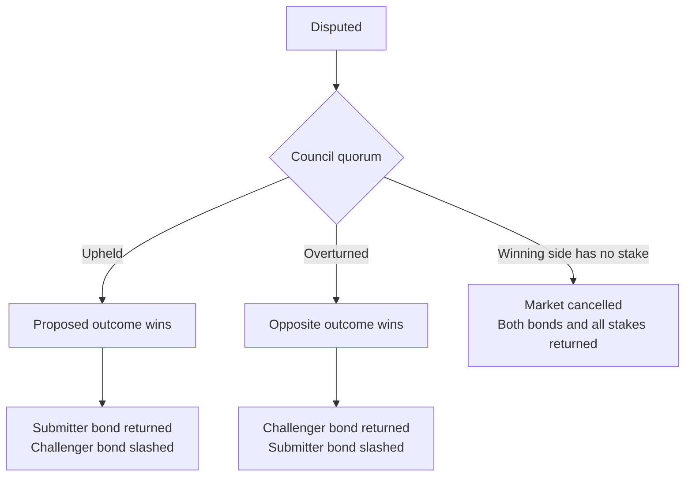

# Optimistic Oracle Lifecycle

How a market outcome is proposed, challenged, voted on and settled. Written for
third-party submitters, disputers and integrators.

> **Implementation status.** This is the target protocol. The code is at
> different stages; check [section 8](#8-implementation-status) before
> depending on any call or amount.

## 1. Overview

Anyone may propose the outcome of an expired market by posting a bond. If nobody
challenges within the window, the outcome becomes final and the bond is returned.
If someone posts a challenge bond, the dispute council decides, and the losing
side's bond is slashed.

| Role | Does | Stakes |
| :--- | :--- | :--- |
| Submitter | Proposes an outcome | Submitter bond |
| Disputer | Challenges a proposal | Challenger bond |
| Council member | Votes on disputes | None |
| Finalizer | Calls `finalize_outcome` (permissionless) | Transaction fee |
| Admin | May veto during the timelock | None |

## 2. State machine



A dispute that upholds the proposal and one that overturns it both end in
`Resolved`; they differ in the winning side and in which bond is slashed:



### Off-chain representation

| Protocol state | `markets.status` (daemon) | `markets.oracle_state` (indexer) | `oracle_submissions.status` |
| :--- | :--- | :--- | :--- |
| Open | `open`, `submitting` | `pending` | none |
| Submitted | `submitted`, `finalizing` | `submitted` | `pending` |
| Disputed / Timelocked | `submitted` | `disputed` | `disputed` |
| Resolved | `resolved` | `finalized` | `finalized` |

`submitting` and `finalizing` are short-lived worker claims. Third-party
submissions are seen only through the indexer, so their `status` remains `open`
until finalized; use `oracle_state` as the authority.

## 3. Bonds

```text
pool             = total YES stake + total NO stake
submitter_bond   = max(100 XLM, pool * 100 / 10_000)
challenger_bond  = max(200 XLM, pool * 100 / 10_000)
```

Amounts are `i128` stroops (1 XLM = 10,000,000 stroops), and division truncates.
Betting closes when an outcome is proposed, so the bond cannot become undersized.

| Pool (XLM) | 1% of pool | Submitter bond | Challenger bond |
| ---: | ---: | ---: | ---: |
| 5,000 | 50 | 100 | 200 |
| 15,000 | 150 | 150 | 200 |
| 100,000 | 1,000 | 1,000 | 1,000 |
| 1,000,000 | 10,000 | 10,000 | 10,000 |

These values come from `contracts/market/src/test.rs`.
[bonds-challenge-slashing.md](bonds-challenge-slashing.md) proposes different
ones (1,000 PERO base, risk-factor scaling). Query `required_bond` rather than
hard-coding either.

## 4. Challenge windows

| Market class | Window (ledgers) | Policy duration |
| :--- | ---: | :--- |
| Standard | 43,200 | ~72 hours |
| High-stakes | 100,800 | ~7 days |
| Critical settlement | 201,600 | ~14 days |

Ledger-to-time conversion assumes six-second ledgers; at five seconds these
counts elapse about 17% sooner. `challenge_deadline = submitted_at + window`. At
or after the deadline a challenge is rejected and `finalize_outcome` is accepted.

The daemon applies one window, `ORACLE_CHALLENGE_WINDOW_SECONDS` (default
259,200 s = 72 h), and checks every `ORACLE_FINALIZE_POLL_MS` (default 60 s).
Anyone else may finalize first; the daemon then reconciles.

## 5. Council voting and quorum

- **Electorate:** registered council members, one vote per dispute each. Votes
  cannot be changed.
- **Quorum:** M-of-N. A side wins on reaching the configured threshold
  (`1 <= threshold <= members`). Votes for the two sides are counted separately;
  turnout alone decides nothing.
- **Operational target:** 4 votes within 24 hours. Beyond that
  `CouncilVoteStalled` fires; after 48 hours emergency governance applies
  ([COUNCIL_RUNBOOK.md](COUNCIL_RUNBOOK.md)).
- **Monitoring default:** if `ORACLE_COUNCIL_QUORUM` is unset, the inactivity
  monitor assumes a strict majority of `ORACLE_COUNCIL_ROSTER`. It does not set
  the on-chain threshold.
- **Timelock:** 12 hours from quorum to `finalize_dispute`. The admin may veto
  during it, which resets all votes; a veto is rejected once it expires.

Appeals (17,280 ledgers, 2x bond) are specified in
[bonds-challenge-slashing.md](bonds-challenge-slashing.md#5-appeals--governance-escalation).

## 6. Slashing and fee incentives

The policy slashes 100% of the losing bond `B` and splits it:

| Recipient | Share | Upheld proposal | Overturned proposal |
| :--- | ---: | :--- | :--- |
| Winning party | 50% | Submitter | Disputer |
| Majority jurors, pro rata | 20% | Council majority | Council majority |
| Treasury | 30% | Protocol | Protocol |

Example with a 1,000 XLM submitter bond overturned: the disputer recovers their
own bond plus 500 XLM, the majority jurors share 200 XLM, and the treasury
receives 300 XLM.

| Event | Submitter | Disputer | Protocol |
| :--- | :--- | :--- | :--- |
| Uncontested | Bond returned | n/a | 2% of pool |
| Upheld | Bond + `0.5 * challenger_bond` | Loses bond | 2% of pool + `0.3 * challenger_bond` |
| Overturned | Loses bond | Bond + `0.5 * submitter_bond` | 2% of pool + `0.3 * submitter_bond` |
| Cancelled | Bond returned | Bond returned | Nothing |

The winners' payout pool is `pool - pool * 200 / 10_000`; each receives
`stake * payout_pool / winning_pool`, truncated. Challenging has positive
expected value when, with probability `p` of winning:

```text
p * 0.5 * submitter_bond > (1 - p) * challenger_bond
```

With equal bonds that is `p > 2/3`: challenge only with strong evidence.

## 7. Code examples

These target the interface used by the oracle daemon: string `market_id`,
boolean `outcome` (`true` = YES), bond in stroops. Confirm it against your
deployment first with `soroban contract invoke --id "$MARKET_CONTRACT_ID" ... -- --help`.

```bash
export MARKET_CONTRACT_ID=C...
export RPC_URL=https://soroban-testnet.stellar.org
export PASSPHRASE="Test SDF Network ; September 2015"
export MARKET_ID=...

invoke() {
  soroban contract invoke --id "$MARKET_CONTRACT_ID" --source "$SOURCE" \
    --rpc-url "$RPC_URL" --network-passphrase "$PASSPHRASE" -- "$@"
}
```

`SOURCE` should be a named CLI identity, not a raw secret key, which other
processes on the host could see.

### Submit an outcome

```bash
SOURCE=submitter
invoke submit_outcome --market_id "$MARKET_ID" --outcome true --bond 1000000000
```

### Challenge an outcome

```bash
SOURCE=disputer
invoke challenge_outcome --market_id "$MARKET_ID" --bond 2000000000
```

### Finalize after the window

```bash
SOURCE=anyone
invoke finalize_outcome --market_id "$MARKET_ID"
```

### Compute bonds in JavaScript

```js
const XLM = 10_000_000n;

/** @param {bigint} pool total stake in stroops */
function requiredBond(pool, { challenge = false } = {}) {
  const base = (challenge ? 200n : 100n) * XLM;
  const scaled = (pool * 100n) / 10_000n;
  return scaled > base ? scaled : base;
}

requiredBond(100_000n * XLM); // 10_000_000_000n (1,000 XLM)
```

### Decide whether to challenge

```js
function shouldChallenge({ proposed, observed, deadline, winProbability, submitterBond, challengerBond }) {
  if (proposed === observed || Date.now() >= Date.parse(deadline)) return false;
  const gain = winProbability * 0.5 * Number(submitterBond);
  const loss = (1 - winProbability) * Number(challengerBond);
  return gain > loss;
}
```

### List active disputes

```bash
curl -s http://localhost:3001/api/v1/oracle/disputes
```

## 8. Implementation status

Where documents and code disagree, the deployed contract is authoritative.

| Capability | Status in this repository |
| :--- | :--- |
| Automated submission and finalization worker | Implemented in `oracle/` |
| Indexing submission, dispute and finalized events | Implemented in `indexer/` |
| Council registry and threshold | Implemented in `contracts/explorer`; not yet read by the market contract |
| `submit_outcome` | `contracts/market` has a different, admin-only, bondless version that resolves immediately |
| `challenge_outcome` | `contracts/market` has a bondless version without a deadline |
| `finalize_outcome`, challenge window | Not in `contracts/market` |
| `required_bond`, escrow, `vote_dispute`, timelock, veto, `finalize_dispute`, `claim` | Described by `contracts/market/src/test.rs`; not in the current `lib.rs` |
| 50/20/30 slashing split | Policy only; the tests in `test.rs` credit the whole forfeited bond to protocol fees |
| Appeals, per-class windows | Policy only |

## See also

- [Bonds, challenge windows and slashing policy](bonds-challenge-slashing.md)
- [Oracle replay defense](oracle-replay-defense.md)
- [Oracle runbook](ORACLE_RUNBOOK.md) and [council runbook](COUNCIL_RUNBOOK.md)
